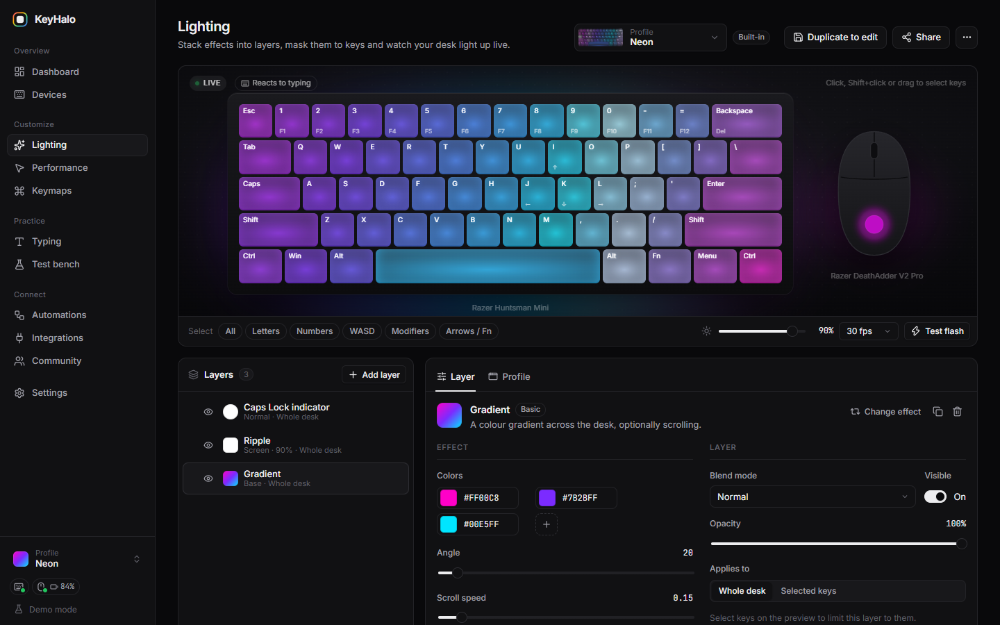
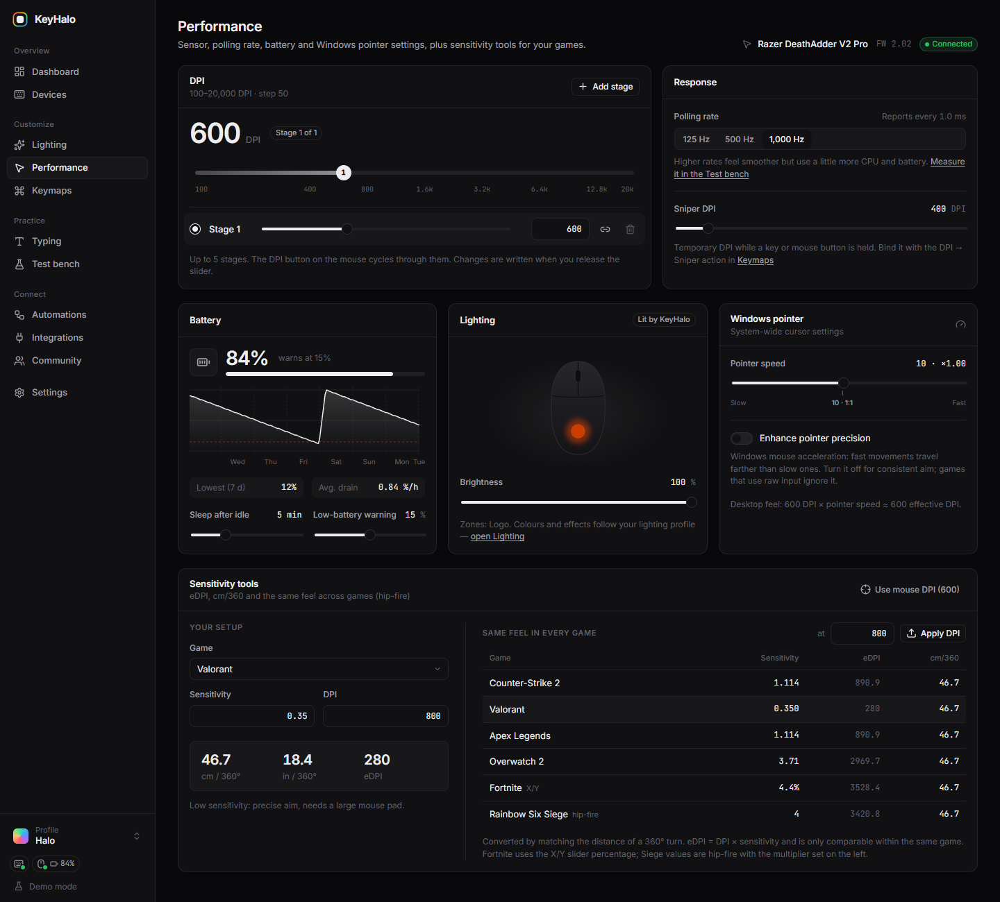
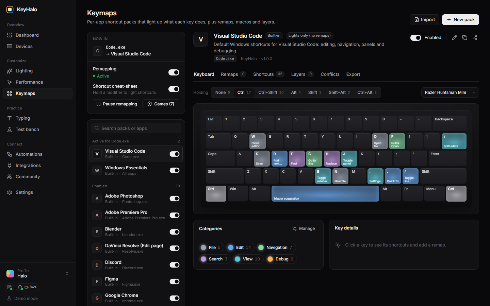
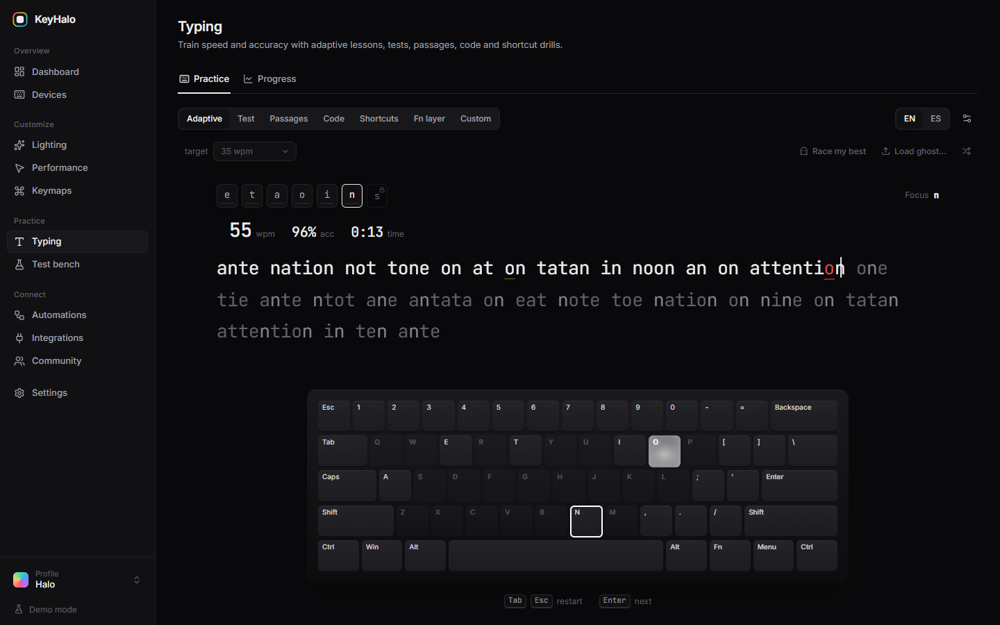
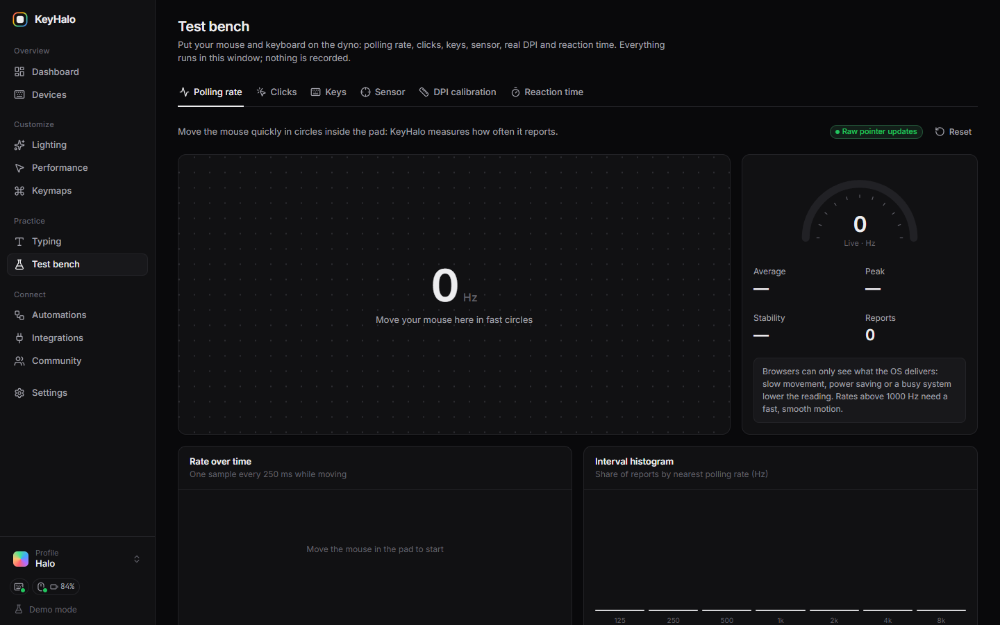
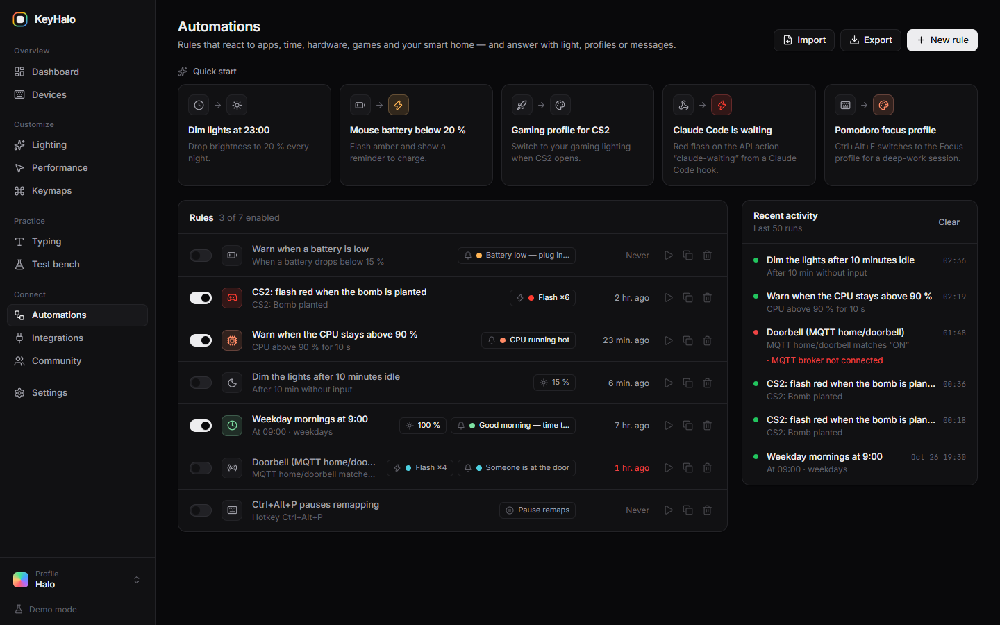
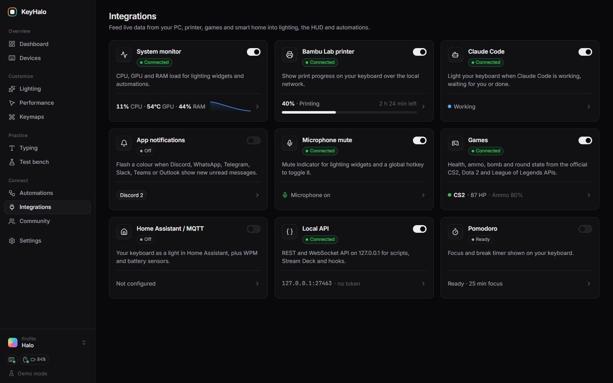
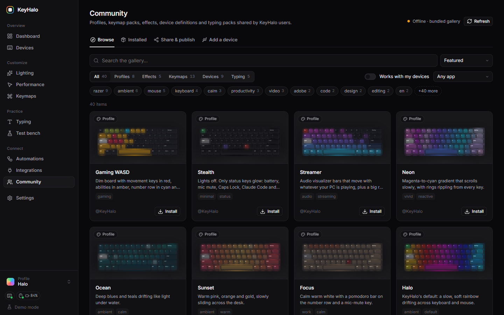
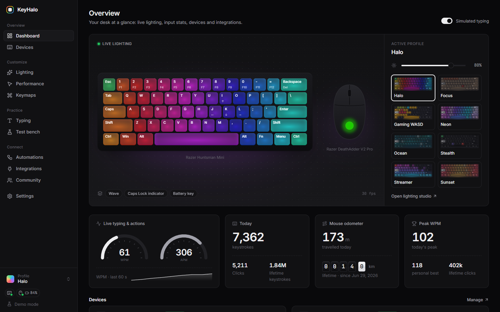

# KeyHalo

**Open-source RGB lighting, macros, per-app keymaps, DPI tuning and a typing trainer for keyboards and mice — a lightweight Razer Synapse alternative for Windows.**

[](LICENSE)
[](https://github.com/Brokenwatch24/keyhalo/releases/latest)
[](https://github.com/Brokenwatch24/keyhalo/actions/workflows/ci.yml)
[](https://github.com/Brokenwatch24/keyhalo/releases/latest)
[](CONTRIBUTING.md)

[Website](https://brokenwatch24.github.io/keyhalo/) · [Download](https://github.com/Brokenwatch24/keyhalo/releases/latest) · [Community gallery](https://brokenwatch24.github.io/keyhalo/gallery/) · [Docs](docs/ARCHITECTURE.md)



KeyHalo is a fast, privacy-first desktop app (Tauri 2 + Rust + React) that replaces heavy
vendor suites for everyday tasks: **per-key RGB lighting**, **mouse DPI and polling rate**,
**per-app keyboard shortcuts and macros**, a **typing trainer**, and a **community gallery**
of profiles, keymaps and device definitions shared on GitHub. It supports **Razer** keyboards
and mice natively and any **Windows Dynamic Lighting (LampArray)** device, with an OpenRGB
bridge for more hardware.

## Features

### Lighting studio

- Per-key RGB editor with **layers** (blend modes, opacity, key masks) and live preview
- Built-in effects (wave, spectrum, breathing, reactive ripples, audio visualiser…) plus
  sandboxed **community effects**
- **Synced lighting** across keyboard, mouse and other devices on a virtual desk
- Save hardware effects to **onboard memory** to keep them without the app running


### Performance tuning

- **DPI stages** (independent X/Y), sniper DPI, **polling rate**
- Battery level and history, idle sleep and low-battery threshold for wireless mice
- Windows pointer speed and acceleration in one place



### Per-app keymaps & macros

- Keymap packs that switch automatically with the **focused app** (DaVinci Resolve, VS Code,
  Photoshop, games…)
- **Shortcut legends**: keys light up by category with the app's own shortcuts
- Remaps, layers, tap-hold, macros, media keys and DPI actions; import from VS Code, export
  to Kanata
- Remapping pauses automatically in competitive games



### Typing trainer

- Words, quotes, code and adaptive lessons in several languages
- WPM, accuracy, consistency, per-key **heatmap** on your real keyboard layout
- Ghost races against your previous runs



### Test bench

- Check every key, switch and mouse button, and measure your mouse's real polling rate



### Automations

- Rules: when an app opens, a time arrives, the battery is low, the PC is idle or the CPU/GPU
  is hot → switch profile, flash keys, notify, change DPI, call MQTT or HTTP



### Integrations

- **Bambu Lab** 3D printers: print progress on your keyboard
- **Claude Code**: see when your AI agent needs you
- **Home Assistant / MQTT**
- Game state lighting for **CS2**, **Dota 2** and **League of Legends**



### Community gallery

- Browse, install and update profiles, keymap packs, effects, typing packs and device
  definitions from this repository
- Publish your own straight from the app (it opens the pull request for you) or share a
  Gist link



### Privacy-first & open source

- No account, no telemetry, no cloud. Everything stays on your PC
- MIT-licensed, small, and it **never flashes firmware**



More screenshots: [devices](docs/screenshots/devices-dark.png) ·
[settings](docs/screenshots/settings-dark.png)

## Supported devices

<!-- devices:start -->
| Device | Type | Connection | USB ID | Status |
|---|---|---|---|---|
| Razer Basilisk V3 | Mouse | Razer HID | `1532:0099` | ⚠️ Experimental |
| Razer BlackWidow V3 | Keyboard | Razer HID | `1532:024E` | ⚠️ Experimental |
| Razer BlackWidow V3 Tenkeyless | Keyboard | Razer HID | `1532:0A24` | ⚠️ Experimental |
| Razer DeathAdder V2 | Mouse | Razer HID | `1532:0084` | ⚠️ Experimental |
| Razer DeathAdder V2 Mini | Mouse | Razer HID | `1532:008C` | ⚠️ Experimental |
| Razer DeathAdder V2 Pro | Mouse | Razer HID | `1532:007C` `1532:007D` | ✅ Verified |
| Razer Huntsman Mini | Keyboard | Razer HID | `1532:0257` | ✅ Verified |
| Razer Huntsman Mini Analog | Keyboard | Razer HID | `1532:0282` | ⚠️ Experimental |
| Razer Viper Ultimate | Mouse | Razer HID | `1532:007A` `1532:007B` | ⚠️ Experimental |
<!-- devices:end -->

Any keyboard or mouse that supports **Windows Dynamic Lighting (LampArray)** works
generically, with no definition needed. Missing your device? Add it with the in-app
**Device Wizard** or open a
[device support request](https://github.com/Brokenwatch24/keyhalo/issues/new?template=device_request.yml).
Tested it? Send a
["Works on my device" report](https://github.com/Brokenwatch24/keyhalo/issues/new?template=works_on_my_device.yml).

## Install

### Windows installer

Download the latest **`KeyHalo_x.y.z_x64-setup.exe`** (NSIS, recommended) or **`.msi`** from
[Releases](https://github.com/Brokenwatch24/keyhalo/releases/latest) and run it.
Windows 11 is recommended (Windows Dynamic Lighting devices require Windows 11).

### Build from source

```bash
# Requirements: Node.js 22, Rust (rustup), MSVC Build Tools, WebView2
git clone https://github.com/Brokenwatch24/keyhalo.git
cd keyhalo
npm install
npm run app:dev     # run the desktop app
npm run app:build   # build installers into src-tauri/target/release/bundle
```

Just want to look around? `npm run dev` starts a **browser demo with simulated devices** at
<http://localhost:1420>.

## Quick start

1. Install and launch KeyHalo; your devices appear on the **Dashboard**.
2. Open **Lighting**, pick an effect or stack layers, and watch the live preview.
3. In **Performance**, set your DPI stages and polling rate.
4. In **Keymaps**, enable a pack for your favourite app; its shortcuts light up when it's focused.
5. Visit **Community** to install profiles and packs made by others, or share your own.

## Community

Profiles, keymap packs, effects, typing packs and device definitions live in
[`community/`](community/README.md) as plain JSON (effects are small sandboxed JS modules).

- **In-app publish**: Community → Publish signs in with GitHub and opens a pull request for you.
- **Pull request**: add a file and open a PR. CI validates it and comments a summary.
- **Gist links**: share instantly with a `keyhalo://import?gist=<id>` link.

See [CONTRIBUTING.md](CONTRIBUTING.md) for the formats.

## Local API & CLI

KeyHalo exposes a local REST/WebSocket API on `127.0.0.1` (optional token) and a small CLI,
so scripts, Stream Deck buttons and other tools can switch profiles, flash keys or read
device status. See [docs/LOCAL_API.md](docs/LOCAL_API.md).

## Roadmap

- **Linux** support (via OpenRazer / hidraw)
- **macOS** support
- More vendors: Logitech, SteelSeries, Corsair (native or through the OpenRGB bridge)
- Onboard macro storage on supported devices
- More community effects, keymap packs and typing languages

Ideas welcome in [Discussions](https://github.com/Brokenwatch24/keyhalo/discussions).

## FAQ

**Is it safe?**
Yes. KeyHalo **never flashes firmware**; it only sends the same documented runtime commands
vendor software uses. It captures a snapshot of your device before the first change
(**Restore original**), and **Safe mode** turns off every hardware write. Community effects
run sandboxed, and keymap content that launches programs, types text or makes HTTP calls
must be approved by you. See [SECURITY.md](SECURITY.md).

**Will it trigger anti-cheat?**
KeyHalo doesn't inject into games or install kernel drivers. Remapping and macros pause
automatically while games on the pause list (Rainbow Six Siege, Valorant, Fortnite, Apex,
Tarkov… editable) are focused. Still, games with kernel anti-cheat have their own rules:
use macros in competitive games at your own risk.

**Does it replace Razer Synapse?**
For supported devices, yes for lighting, DPI, polling rate and battery. You can uninstall
Synapse, or keep both installed, but don't let both control the lighting at the same time.

**Can it update my device's firmware?**
No, by design. Use the vendor's tool for firmware updates.

**Does it work without an internet connection?**
Yes. The network is only used for the community gallery, GitHub publishing, update checks
and the integrations you enable.

## Contributing

Contributions of all sizes are welcome, from a new device definition to a keymap pack for
your favourite app. Start with [CONTRIBUTING.md](CONTRIBUTING.md) and the
[Code of Conduct](CODE_OF_CONDUCT.md).

## Credits

- [OpenRazer](https://openrazer.github.io) and [OpenRGB](https://openrgb.org) for their
  public protocol research. KeyHalo's implementation is original; no code was copied
  (see [docs/protocols](docs/protocols)).
- [Kanata](https://github.com/jtroo/kanata) for remapping inspiration.
- [Tauri](https://tauri.app), [Inter](https://rsms.me/inter/) and
  [Lucide](https://lucide.dev) icons.

## License

[MIT](LICENSE) © 2026 Brokenwatch24 and KeyHalo contributors.

KeyHalo is not affiliated with or endorsed by Razer, Microsoft or any other hardware vendor.
All trademarks belong to their respective owners.
